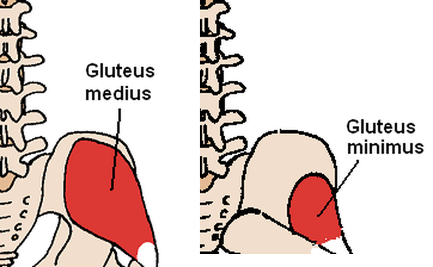

# Hip Stabilizers: Side-Lying Clamshells

## Target muscles

**Gluteus medius and gluteus minimus.** The drawings show each muscle on the hip, seen from behind.

*Image: adapted from "Posterior Hip Muscles 3" and "Posterior Hip Muscles 1" by Beth ohara, licensed under CC BY-SA 3.0. Both drawings were cropped and enlarged, and the red shading and labels of the other deep hip muscles were removed from the gluteus minimus drawing. This adapted image is shared under the same license. Sources: https://commons.wikimedia.org/wiki/File:Posterior_Hip_Muscles_3.PNG and https://commons.wikimedia.org/wiki/File:Posterior_Hip_Muscles_1.PNG. License: https://creativecommons.org/licenses/by-sa/3.0/*

## What these muscles do

The gluteus medius steadies your pelvis, while the gluteus minimus steadies the hip joint itself.

- **Gluteus medius:** keeps your pelvis and hip steady when you stand on one leg ([Moore 2020](https://pmc.ncbi.nlm.nih.gov/articles/PMC7727410/)).
- **Gluteus minimus:** attaches partly to the hip joint capsule. It helps hold the ball of the hip in its socket by tightening the capsule and pressing on the head of the thighbone ([Beck 2000](https://boneandjoint.org.uk/Article/10.1302/0301-620X.82B3.0820358)).
- **Why your ankle stays up:** lifting the ankle turns your hip inward, and the front part of the gluteus minimus is highly active when the hip turns inward ([Moore 2020](https://pmc.ncbi.nlm.nih.gov/articles/PMC7727410/)).

## Setup

1. Lie on your side with your knees bent to 90°. Keep this bend for the whole exercise.
2. Roll your torso all the way forward.
3. Tighten your abs, pulling your belly button toward your spine. Hold this for the whole exercise.

## Movement

1. Keep your knees together and lift your top ankle. Hold your leg in this position for the whole exercise.
2. Lift your top knee, stopping before you lose your rolled-forward position.
3. Lower the knee, keeping your ankle lifted.

## Dosage

Repeat until fatigue or 15 reps, whichever comes first. Rest, then do a second set.

## Check on every rep

- Torso stays rolled forward.
- Abs stay tight.
- Knees stay bent to 90°.
- Ankle stays lifted.

## Sources

- Moore D, Semciw AI, Pizzari T. [A systematic review and meta-analysis of common therapeutic exercises that generate highest muscle activity in the gluteus medius and gluteus minimus segments](https://pmc.ncbi.nlm.nih.gov/articles/PMC7727410/). Int J Sports Phys Ther. 2020;15(6):856-881.
- Beck M, Sledge JB, Gautier E, Dora CF, Ganz R. [The anatomy and function of the gluteus minimus muscle](https://boneandjoint.org.uk/Article/10.1302/0301-620X.82B3.0820358). J Bone Joint Surg Br. 2000;82-B(3):358-363.
- Beth ohara. [Posterior Hip Muscles 3](https://commons.wikimedia.org/wiki/File:Posterior_Hip_Muscles_3.PNG) and [Posterior Hip Muscles 1](https://commons.wikimedia.org/wiki/File:Posterior_Hip_Muscles_1.PNG). Wikimedia Commons, 2006. [CC BY-SA 3.0](https://creativecommons.org/licenses/by-sa/3.0/).
