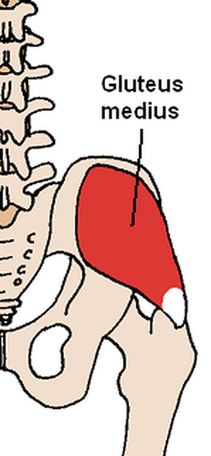

# Hip Stabilizers: Side-Lying Leg Lift (Gluteus Medius)

**Target muscle: gluteus medius**

## Setup

1. Lie on your unaffected side with your knees bent to about 45°.
2. Roll your torso fully forward.
3. Draw your belly in toward your spine. Hold it there for the whole set.

## Movement

1. Keep your knees together and rotate your top leg so your ankle is as high as it will go. This feels awkward on purpose: it makes compensation less likely.
2. Slowly lift the whole top leg, keeping the 45° knee bend and your ankle high. Lift only as far as is comfortable, and stop before your torso starts to roll back.
3. Slowly lower the leg, keeping your ankle high.

## Check on every rep

- Torso stays rolled forward.
- Abs stay drawn in.
- Ankle stays as high as it can, going up and coming down.
- Move slowly and on purpose, and picture your gluteus medius (shown above) working as you go.
